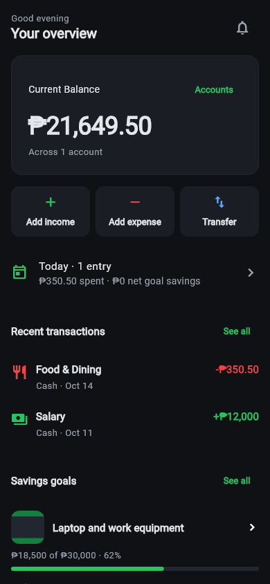
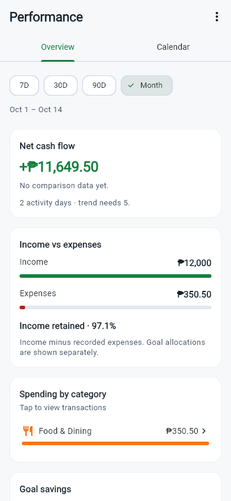

# MoneyFlow

MoneyFlow is a personal finance and savings app built with Flutter. Record everyday spending, track balances across cash wallets and bank accounts, and plan contributions toward savings goals.

It is a manual tracker: it does not connect to banks or move real money. Records are stored locally in SQLite.

## Features

- **Accounts and transactions:** record income, expenses, withdrawals and transfers; search history and reuse custom categories.
- **Savings goals:** set a target and date, track contributions and withdrawals, and review daily, weekly and monthly recommendations. Goals can have a photo and an activity history.
- **Daily overview:** see current balances, recent transactions, today's activity and active goals.
- **Performance:** explore period summaries, spending by category, a financial calendar, journals, streaks and monthly reviews.
- **Planning:** set category budgets and recurring transaction rules.
- **Preferences:** choose light, dark or system appearance and a display currency.
- **Backups:** export a JSON file or restore a validated backup with confirmation.

Transfers change the two account balances without counting as income or expenses. Goal contributions allocate savings separately; they do not deduct money from an account. Currency preferences change formatting, not exchange rates. Recurring rules are processed when the app starts or when Run Due is used, rather than by a background payment service.

## Screenshots

These widget-test renders use synthetic financial records, not personal data. They show the existing dark and light themes; they are not photographs of a device.

| Home | Performance |
| --- | --- |
|  |  |

## Run on Android

Requirements:

- Flutter stable with Dart compatible with `^3.9.2` (see `pubspec.yaml`).
- Android Studio or Android SDK command-line tools, a compatible JDK, and accepted Android SDK licenses. Run `flutter doctor` to check the toolchain.
- An Android emulator or a device with USB debugging enabled.

The repository checks were run with Flutter 3.35.7 and Dart 3.9.2.

From the repository directory:

```sh
flutter doctor
flutter pub get
flutter devices
flutter run -d <android-device-id>
```

Replace `<android-device-id>` with an ID from `flutter devices`. Dependency installation needs internet access. Normal financial tracking uses local storage and needs no API key, backend account or database server. Keep `pubspec.lock` for reproducible dependency resolution.

Android is the release target validated here. The other Flutter platform folders are retained for maintenance, but their presence does not mean those platforms are supported or tested. In particular, the current SQLite setup is not a web storage implementation.

## Checks and builds

```sh
flutter analyze
flutter test --reporter expanded
flutter build apk --debug
```

The debug APK is written to `build/app/outputs/flutter-apk/app-debug.apk`. Tests use isolated data and cover financial calculations, persistence, backup validation, forms and responsive layouts. They do not replace testing native pickers, accessibility and upgrades on a phone.

Release signing is separate. Follow [RELEASE_SETUP.md](RELEASE_SETUP.md) before building an Android App Bundle. Release builds intentionally fail when private signing credentials are missing.

## Data and privacy

The app starts empty. Optional demo records are available only through debug settings. Backups contain readable financial records, notes and goal photos; they are not encrypted. Keep them private and export one before uninstalling or changing devices. Clear all data does not delete exported backups or retained older internal snapshots.

Android automatic backup and device-transfer exclusions are configured in the project. Their behavior still needs verification on supported Android devices. There is no app-managed cloud sync.

Do not commit personal databases, exported backups, signing keys, credentials or logs. See the [release checklist](RELEASE_SETUP.md) for the remaining privacy and publication checks.

## Project guide

- `lib/app/`: navigation and themes.
- `lib/core/`: shared components, formatting and financial utilities.
- `lib/data/`: SQLite schema, models, repositories, backups and recalculation.
- `lib/features/`: accounts, transactions, goals, Home, Performance and Settings.
- `test/`: isolated database and widget regression tests.
- `assets/brand/` and `tool/`: logo source and platform icon export tool.
- `docs/`: maintenance guidance, screenshots and dated QA records.

Read [development notes](docs/DEVELOPMENT.md) before changing financial rules or storage. Dated reviews document earlier findings; they are not a current list of unresolved bugs.

## License

The repository includes the [GNU Lesser General Public License v2.1](LICENSE). Dependency and platform asset licenses remain applicable.
